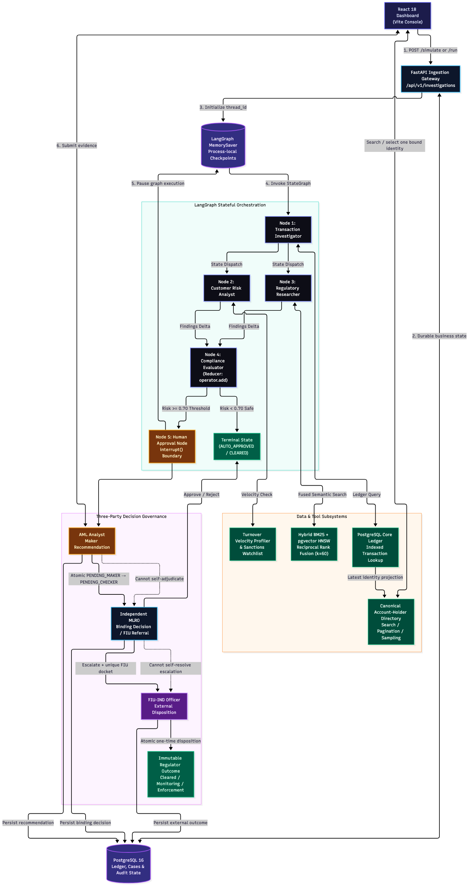

# FinSight AI — Enterprise Multi-Agent AML Compliance & Governance Platform



FinSight AI is a production-minded portfolio implementation of an Anti-Money Laundering (AML) regulatory intelligence and transaction monitoring engine. It demonstrates the statutory **Four-Eyes Principle (Dual-Control)**, RFC 6238 TOTP two-factor authentication, stateful multi-agent orchestration via LangGraph, and hybrid Reciprocal Rank Fusion (RRF) search over regulatory circulars.

## Documentation

- [Documentation hub](docs/README.md)
- [Complete end-to-end project documentation](docs/PROJECT_DOCUMENTATION.md)
- [Complete project documentation PDF](output/pdf/FinSight_AI_Project_Documentation.pdf)
- [Free Render + Neon deployment guide](docs/DEPLOY_RENDER.md)
- [Mermaid architecture source](architecture.mmd)

---

## 🏛️ Core Architecture & Capabilities

### 1. Institutional Four-Eyes Principle (Maker-Checker Governance)
- **Analyst Desk (Maker)**:
  - Searches and pages across the canonical core-ledger account-holder directory; selecting a holder binds the customer ID, current name, and historical baseline as one consistent identity.
  - Profiles incoming transactions against 30-day moving turnover baselines.
  - Computes velocity deviation multipliers and triggers LangGraph multi-agent investigations.
  - Submits formal recommendations (`RECOMMEND_REJECT`, `RECOMMEND_ESCALATE`, `RECOMMEND_APPROVE`).
  - Uses one unambiguous **Start New Case** action after the current Maker step is complete.
- **MLRO Executive Desk (Checker)**:
  - Holds exclusive legal authority to issue binding statutory rulings (`ACCOUNT_FREEZE`, `ESCALATE`, `APPROVE`) and file Suspicious Activity Reports (SARs) with regulatory bodies (e.g., FIU-IND).
  - Test sliders and manual creation controls are strictly prohibited and hidden on this desk.
  - Features stream anomaly ingestion from an indexed synthetic core-banking ledger. The hosted preview seeds 10,000 rows; an optional local generator supports a 1,000,000-row benchmark dataset.
- **FIU External Disposition Desk (Regulator)**:
  - Receives only MLRO-escalated cases and cannot access the internal Maker or Checker actions.
  - Records a unique FIU acknowledgement/order reference, rationale, and one terminal outcome: no further action, continued monitoring, or enforcement referral.
  - Uses an atomic one-time transition so duplicate or concurrent dispositions cannot overwrite the first official outcome.
- **Strict Duty Segregation**:
  - The API programmatically prevents an officer from adjudicating any case where they served as the Maker (`HTTP 403 Forbidden`).
  - Maker and checker transitions use atomic compare-and-set updates. Concurrent duplicate submissions produce one success and one `HTTP 409 Conflict`; a case can never be ruled on twice.
  - Every successful transition increments `decision_version` and appends an actor/timestamp event to the case execution trace.

### Approval and Escalation Lifecycle

| State | Owner | Allowed next action | Mutability |
|---|---|---|---|
| `PENDING_MAKER` | AML Analyst | Submit one evidence-backed recommendation | Editable by Maker |
| `PENDING_CHECKER` | Independent MLRO | Approve, reject, or refer outside bank authority | Transaction details locked |
| `FINALIZED` | Core ledger | None | Immutable |
| `ESCALATED_FIU` | FIU-IND officer | Record one external disposition | Read-only to Analyst and MLRO |
| `REGULATOR_CLEARED` | Core ledger | None | Immutable |
| `REGULATOR_MONITORING` | Core ledger | None | Immutable |
| `REGULATOR_ENFORCEMENT` | Core ledger | None | Immutable |

An escalation is not a checker approval. It creates a unique FIU-IND docket, records `PENDING_REGULATOR`, freezes internal adjudication, and transfers jurisdiction to the regulator-only queue. The original Maker recommendation and MLRO referral remain immutable when the FIU outcome is appended.

### 2. Multi-Agent Reasoning Graph (LangGraph)
- **Transaction Investigator**: Analyzes transaction payload, corridor risk, payment channel (SWIFT, RTGS, IMPS, UPI), and counterparty linkages.
- **Customer Risk Analyst**: Evaluates customer profiling, historical averages, turnover velocity spikes, and watchlist hits.
- **Regulatory Researcher**: Performs hybrid dense-sparse RRF retrieval across statutory master directions (RBI, FATF, PMLA) using BM25 and PostgreSQL `pgvector`.
- **Compliance Evaluator**: Synthesizes agent deltas into a cumulative risk score [0.0, 1.0], triggering mandatory human intervention when risk exceeds the 70% institutional threshold.

### 3. Enterprise Database Connection Resilience
- **Sleep/Wake & Severed Socket Auto-Recovery**:
  - Configured with `pool_pre_ping=True` to eliminate broken pipe exceptions caused by machine sleep/wake cycles or firewall timeouts.
  - Connection recycling with `pool_recycle=300` (5 minutes) prevents stale OS socket reuse.
  - Persistent pool sizing (`pool_size=10`, `max_overflow=20`) supports concurrent burst throughput.

### 4. Robust Security & Authentication
- **RFC 6238 Time-Based Rolling One-Time Passwords (TOTP)**:
  - Two-step authentication flow with QR code pairing for Google Authenticator / Microsoft Authenticator.
- **Session Interceptor**:
  - Dual Bearer token and secure HTTP-only cookie support.
  - Centralized frontend client interceptor catches HTTP 401 session expiry and prompts re-authentication cleanly.
  - Explicit bearer credentials take precedence over stale cookies during officer switching.
  - MFA seeds and local authenticator pairing are available only when `DEMO_MODE=true`; production never returns TOTP secrets.

### Production Environment

Set `APP_ENV=production`, a high-entropy `JWT_SECRET_KEY`, `COOKIE_SECURE=true`, `DEMO_MODE=false`, `VITE_DEMO_MODE=false`, externally managed officer passwords/TOTP seeds, and an explicit comma-separated `ALLOWED_ORIGINS` list. The API refuses to start in production when the JWT or identity secrets are missing. See `.env.example` for the complete configuration.

The production images are separate from the hot-reload development images. After supplying the required secrets, run:

```bash
docker compose -f docker-compose.prod.yml up --build -d
```

The frontend serves the optimized Vite bundle through Nginx, proxies `/api` over the private Compose network, and exposes `/healthz`. The backend `/health` endpoint verifies database connectivity and all required schemas before reporting ready.

### Render deployment

The checked-in `render.yaml` provisions a no-cost, no-fixed-expiry portfolio preview: one combined React/FastAPI service on Render Free backed by Neon Free PostgreSQL/pgvector. Both providers scale idle compute to zero, so the first request can be slower, but persisted database storage does not have Render's 30-day free-database expiry. The optional `render.paid.yaml` preserves the separated public-frontend/private-API production topology. Follow [docs/DEPLOY_RENDER.md](docs/DEPLOY_RENDER.md) to create Neon, generate fresh officer credentials, apply the Blueprint, and verify the complete Maker–Checker–Regulator workflow.

---

## 🚀 Quick Start Guide

### Prerequisites
- Python 3.9+
- Node.js 18+ & npm
- Docker & Docker Compose

### 1. Database Infrastructure
Launch PostgreSQL 16 with `pgvector` enabled:
```bash
docker compose -f docker-compose.dev.yml up -d
```

### 2. Backend Setup
```bash
cd backend
python3 -m venv venv
source venv/bin/activate
pip install -r requirements.txt

# Run Uvicorn development server
uvicorn app.main:app --host 0.0.0.0 --port 8000 --reload
```

### 3. Frontend Setup
```bash
cd frontend
npm install
npm run dev
```
Open [http://localhost:3000](http://localhost:3000) in your browser.

---

## 👥 Pre-Provisioned Personas

| Username | Role | Desk / Responsibility | TOTP Seed (Base32) | Default Password |
|---|---|---|---|---|
| `officer.sharma` | **MLRO_OFFICER** (Checker) | Executive Adjudication & Freezes | `JBSWY3DPEHPK3PXP` | `Compliance@2026` |
| `analyst.verma` | **ANALYST** (Maker) | Transaction Triage & Investigation | `HXDMVJECJJWSRB3H` | `Analyst@2026` |
| `regulator.iyer` | **REGULATOR_OFFICER** (FIU) | External Disposition & Enforcement | `JBSWY3DPEHPK3PXP` | `Regulator@2026` |

These convenience personas appear in the UI only when `VITE_DEMO_MODE=true`; the API returns pairing secrets only when `DEMO_MODE=true`. Disable both flags outside local demonstrations.

---

## 🧪 Testing & Verification

Run the complete workflow and hybrid RAG test suites:
```bash
docker compose -f docker-compose.dev.yml exec -T backend pytest -q
```

Check API Telemetry:
```bash
curl -s http://localhost:8000/health
# Response: {"status":"HEALTHY","system":"FinSight AI Enterprise Engine"}
```

---

## 📄 License

Copyright © 2026 FinSight AI. All rights reserved. This repository is publicly
viewable for evaluation and interview review, but reuse, modification,
redistribution, commercial use, hosting, and deployment are prohibited without
prior written permission. See the [LICENSE](LICENSE) file for the complete terms.
