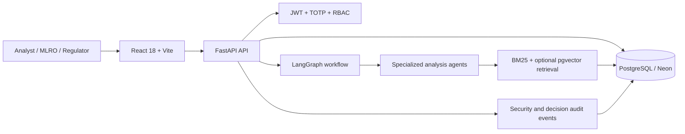

# FinSight AI: End-to-End Project Documentation

**Version:** 2.0  
**Application type:** Agentic AML decision-support and governance platform  
**Primary stack:** React, FastAPI, LangGraph, PostgreSQL, pgvector, BM25, Docker  
**Hosted preview:** [https://finsight-ai-compliance-demo.onrender.com](https://finsight-ai-compliance-demo.onrender.com)  
**Health endpoint:** [https://finsight-ai-compliance-demo.onrender.com/health](https://finsight-ai-compliance-demo.onrender.com/health)

> FinSight AI is a production-minded portfolio implementation. It demonstrates controls expected in regulated decision workflows, but it is not a certified banking product and must not process real customer data without a formal security, privacy, legal, model-risk, and infrastructure review.

## 1. Executive summary

FinSight AI investigates potentially suspicious financial transactions and converts machine-generated evidence into a controlled human decision workflow. It combines deterministic transaction analysis, customer-velocity profiling, regulatory retrieval, optional LLM-assisted synthesis, and human-in-the-loop governance.

The central design principle is that AI provides evidence and recommendations; it does not receive authority to issue a binding statutory decision. High-risk cases move through three segregated roles:

1. An **Analyst (Maker)** investigates and submits a recommendation.
2. An independent **MLRO (Checker)** confirms, overrides, or escalates the recommendation.
3. An **FIU-IND Regulator** records the terminal external disposition of an escalated case.

The database is the workflow authority. Conditional updates, partial unique indexes, immutable terminal states, and audit events protect against duplicate requests, concurrent clicks, browser retries, and unauthorized state transitions.

## 2. Goals and non-goals

### 2.1 Goals

- Demonstrate explainable multi-agent transaction analysis.
- Ground regulatory rationale in retrieved statutory evidence.
- Enforce Maker–Checker segregation of duties.
- Model escalation as a separate transfer of authority, not an approval variant.
- Prevent duplicate cases and duplicate decisions at the database boundary.
- Continue producing evidence when the external model provider is unavailable.
- Provide auditable authentication, workflow, and disposition events.
- Offer a reproducible local environment and a zero-cost portfolio deployment path.

### 2.2 Non-goals

- Replacing a bank's core transaction-monitoring platform.
- Claiming regulatory certification or legal sufficiency.
- Processing real PII, customer records, or production watchlists.
- Training a fraud-detection model from historical labels.
- Providing a live sanctions, PEP, adverse-media, or case-management vendor integration.
- Guaranteeing availability or latency on free hosting infrastructure.

## 3. Key terminology

| Term | Meaning in FinSight |
|---|---|
| AML | Anti-Money Laundering |
| Maker | Analyst who opens a high-risk case and records a recommendation |
| Checker | Independent MLRO officer who records the binding internal outcome |
| FIU-IND | External regulator role represented in the demonstration |
| HITL | Human-in-the-loop review required at or above the risk threshold |
| RAG | Retrieval-Augmented Generation |
| BM25 | Sparse term-based ranking used for exact statutory matching |
| pgvector | PostgreSQL extension used for vector storage and similarity search |
| RRF | Reciprocal Rank Fusion, used to combine dense and sparse rankings |
| CAS transition | Compare-and-set database update that succeeds only from the expected state |
| Canonical case | The single non-superseded case associated with a transaction |

## 4. System context



### 4.1 Component responsibilities

| Component | Responsibility |
|---|---|
| React frontend | Role-specific workspaces, case entry, evidence review, adjudication, and audit-log presentation |
| FastAPI backend | Validation, authentication, authorization, workflow APIs, health checks, and response shaping |
| LangGraph | State-oriented orchestration of specialized analysis nodes and HITL routing |
| PostgreSQL | Transactions, account identities, case state, regulatory chunks, user records, replay protection, and audit history |
| pgvector | Optional dense vector retrieval with cosine similarity and HNSW indexing |
| BM25 | In-memory sparse retrieval over the approved regulatory corpus |
| OpenAI integration | Optional embeddings and two-sentence regulatory rationale synthesis |
| Docker | Reproducible development, production, and combined Render images |
| Render + Neon | Hosted portfolio preview with a stateless web service and persistent external PostgreSQL database |

## 5. Repository structure

```text
finsight-ai/
├── backend/
│   ├── app/
│   │   ├── agents/          # Investigator, risk, researcher, evaluator nodes
│   │   ├── api/             # FastAPI request models and route handlers
│   │   ├── auth/            # Password, MFA, JWT, revocation, and RBAC controls
│   │   ├── graph/           # LangGraph state, nodes, routing, and checkpoint setup
│   │   ├── models/          # SQLAlchemy entities
│   │   ├── rag/             # Regulatory corpus and hybrid retriever
│   │   ├── tools/           # Ledger, velocity, and watchlist tools
│   │   ├── database.py      # Sync and async PostgreSQL engines
│   │   ├── demo_seed.py     # Idempotent 10,000-record hosted seed
│   │   └── main.py          # FastAPI application and combined static serving
│   ├── tests/               # Workflow, security, concurrency, and retrieval tests
│   ├── seed_large_ledger.py # Local synthetic ledger seed
│   └── seed_1m_records.py   # Optional large local benchmark data generator
├── frontend/
│   ├── public/              # Browser favicon and public assets
│   ├── src/App.jsx          # Role-aware application interface and API integration
│   └── src/index.css        # Institutional dashboard styling
├── docs/                    # Technical and deployment documentation
├── architecture.mmd         # Mermaid architecture source
├── Dockerfile.render-free   # Combined frontend/backend free-hosting image
├── docker-compose.dev.yml   # Hot-reload local environment
├── docker-compose.prod.yml  # Separated self-hosted production topology
├── render.yaml              # Free Render + external Neon Blueprint
└── render.paid.yaml         # Optional paid separated Render topology
```

## 6. End-to-end transaction flow

### 6.1 Authentication

1. The user submits a username and password to `POST /api/v1/auth/login-step1`.
2. The server verifies the password using a constant-time comparison.
3. The server issues a five-minute JWT whose stage is `MFA_PENDING` and whose `jti` is unique.
4. The user submits the six-digit TOTP code and challenge token to `POST /api/v1/auth/verify-mfa`.
5. The challenge `jti` is atomically inserted into `used_mfa_challenges`. Reuse is rejected.
6. The server issues an eight-hour authenticated JWT and a secure HTTP-only session cookie.
7. Every protected endpoint reconstructs the user principal and enforces its permitted roles.

Production mode never returns the TOTP seed or provisioning URI to the browser.

### 6.2 Analyst investigation

1. The Analyst searches or samples the canonical `account_holders` directory.
2. Selecting a holder binds the customer ID, displayed name, and historical baseline together.
3. The Analyst submits a transaction to `POST /api/v1/investigations/simulate`.
4. The API first searches for an existing active case for the transaction or customer.
5. An existing case owned by the same Analyst is restored instead of duplicated.
6. A conflicting case owned by another workflow returns HTTP `409`.
7. The transaction is stored in the partitioned ledger and the account-holder projection is updated.
8. The LangGraph investigation executes. If graph execution is unavailable, deterministic evidence is generated.
9. Low-risk cases are finalized automatically. High-risk cases enter `PENDING_MAKER`.

### 6.3 Maker recommendation

The Analyst records one of:

- `RECOMMEND_APPROVE`
- `RECOMMEND_REJECT`
- `RECOMMEND_ESCALATE`

The recommendation requires a meaningful findings memo. The API performs an atomic transition from `PENDING_MAKER` to `PENDING_CHECKER`. A repeated or concurrent submission receives HTTP `409`.

### 6.4 Checker adjudication

The MLRO reviews the original recommendation, evidence, policies, risk score, and audit trace. The MLRO can confirm or override the Maker with a required statutory memo.

- Approval or rejection moves the case to terminal `FINALIZED`.
- Escalation generates a unique FIU docket and moves the case to `ESCALATED_FIU`.
- The Maker cannot adjudicate their own case.
- A second Checker request cannot modify an already transitioned record.

### 6.5 Regulator disposition

Only a Regulator can access the external queue or close `ESCALATED_FIU` cases. One of three terminal outcomes is recorded:

- `NO_FURTHER_ACTION` → `REGULATOR_CLEARED`
- `CONTINUE_MONITORING` → `REGULATOR_MONITORING`
- `ENFORCEMENT_REFERRED` → `REGULATOR_ENFORCEMENT`

The FIU acknowledgement reference is unique. The first successful disposition is immutable; concurrent attempts receive HTTP `409`.

## 7. Workflow state machine

| Current state | Authority | Permitted transition | Result |
|---|---|---|---|
| `PENDING_MAKER` | Owning Analyst | Submit recommendation | `PENDING_CHECKER` |
| `PENDING_CHECKER` | Independent MLRO | Approve or reject | `FINALIZED` |
| `PENDING_CHECKER` | Independent MLRO | Escalate | `ESCALATED_FIU` |
| `ESCALATED_FIU` | FIU Regulator | No further action | `REGULATOR_CLEARED` |
| `ESCALATED_FIU` | FIU Regulator | Continue monitoring | `REGULATOR_MONITORING` |
| `ESCALATED_FIU` | FIU Regulator | Enforcement referral | `REGULATOR_ENFORCEMENT` |
| Any terminal state | None | No transition | Immutable |
| Duplicate legacy row | System migration | Supersede | `DUPLICATE_SUPERSEDED` |

Every successful human transition increments `decision_version` and appends an actor, timestamp, event, and decision to `execution_trace`.

## 8. Agentic AI workflow

### 8.1 Shared state

`ComplianceState` is a typed dictionary containing transaction identity, transaction data, findings, retrieved policies, cumulative score, review status, final verdict, and execution trace. Findings, policies, and trace entries use additive reducers so fan-out nodes can contribute without overwriting each other.

### 8.2 Nodes

#### Transaction Investigator

- Loads the transaction through an indexed PostgreSQL lookup.
- Examines amount, channel, and first-time-beneficiary status.
- Produces a structured `Finding` with a risk level, score delta, explanation, and evidence.

#### Customer Risk Analyst

- Calculates the ratio between the incoming amount and historical baseline.
- Flags a velocity breach above `10x`.
- Runs the demonstration watchlist/PEP screening tool.
- Produces separate velocity and entity-risk findings.

#### Regulatory Researcher

- Builds a query from transaction amount, beneficiary novelty, channel, narration, and compliance concepts.
- Loads the approved regulatory corpus.
- Runs BM25 and optional dense retrieval.
- Fuses the rankings using RRF.
- Optionally asks the configured chat model for a concise grounded rationale.
- Falls back to deterministic regulatory language when the model is unavailable.

#### Compliance Evaluator

- Sums the structured score deltas.
- Rounds and clamps the score to `[0.0, 1.0]`.
- Routes scores at or above `0.70` to human review.
- Auto-clears very low risk and auto-approves other below-threshold cases.

### 8.3 Current checkpoint behavior

The current graph compiles with LangGraph `MemorySaver`. Graph checkpoints therefore exist only for the life of the backend process. Durable compliance case state and binding outcomes are stored separately in PostgreSQL and remain authoritative across restarts.

**Production evolution:** Replace `MemorySaver` with a PostgreSQL checkpointer, configure replay-safe node behavior, and persist model/prompt versions with each checkpoint. `DATABASE_CHECKPOINT_URL` is currently reserved for that evolution and for data-generation scripts; it is not the active graph checkpoint store.

## 9. Hybrid regulatory retrieval

### 9.1 Sparse retrieval

The application loads `regulatory_chunks` and creates an in-memory `BM25Okapi` index. BM25 is useful for exact terms such as section numbers, notification identifiers, regulatory acronyms, and statutory phrases.

### 9.2 Dense retrieval

When `OPENAI_API_KEY` is configured and the corpus contains embeddings, the query is embedded and compared against `vector(1536)` rows using cosine distance. PostgreSQL uses an HNSW index configured with `m=16` and `ef_construction=64`.

### 9.3 Reciprocal Rank Fusion

Dense and sparse results have incompatible raw scoring scales. FinSight combines their ranks instead:

```text
RRF(document) = Σ 1 / (k + rank_i(document))
```

The implementation uses `k=60`, retrieves up to 15 candidates from each channel, and returns the highest-ranked fused evidence.

### 9.4 Degraded mode

- If no API key is configured, dense retrieval returns no candidates.
- If embedding generation fails, the exception is isolated and sparse evidence remains available.
- If LLM synthesis fails, deterministic rationale is returned.
- If the graph as a whole fails, the API constructs deterministic transaction, risk, and regulatory findings before persisting the case.

This behavior prioritizes availability and explainability over model dependence.

## 10. Risk scoring

The current score is a transparent policy score, not a trained probability of money laundering.

Representative signals include:

| Signal | Representative delta |
|---|---:|
| High-value transfer to a first-time beneficiary | `+0.45` |
| Elevated transfer or new beneficiary | `+0.25` |
| Low nominal transfer | `+0.05` |
| Velocity breach above `10x` baseline | `+0.35` |
| Moderate velocity deviation | `+0.20` |
| Demonstration watchlist match | `+0.40` |
| High-risk regulatory condition | `+0.30` |

The final score is capped at `1.0`. A score of `0.70` or higher requires human review.

**Production evolution:** Calibrate the score and threshold against labeled historical outcomes, asymmetric false-negative costs, precision-recall curves, calibration error, and jurisdiction-specific policy. Version all rules and preserve the active version on each case.

## 11. Consistency, concurrency, and idempotency

### 11.1 Database-enforced uniqueness

Partial unique indexes enforce:

- One canonical non-superseded case per transaction.
- One active review per account holder across `PENDING_MAKER`, `PENDING_CHECKER`, and `ESCALATED_FIU`.
- Unique FIU docket identifiers.
- Unique regulator acknowledgement references.

### 11.2 Compare-and-set transitions

Workflow mutations use statements conceptually equivalent to:

```sql
UPDATE compliance_cases
SET status = 'PENDING_CHECKER', decision_version = decision_version + 1
WHERE case_id = :case_id
  AND status = 'PENDING_MAKER'
RETURNING *;
```

Only the request that observes the expected state can update it. A concurrent loser receives HTTP `409`, even if both requests passed an earlier read check.

### 11.3 Retry behavior

- Repeating case creation for the same transaction restores the existing case when the same Analyst owns it.
- Creating a different transaction for an account already under active review restores or blocks according to ownership and status.
- New cases are blocked while the account is under FIU review.
- Logout does not delete case state; the next session restores the Analyst's open case.

### 11.4 Schema initialization

Startup initialization is protected by PostgreSQL advisory transaction locks. Schema creation and seed operations are idempotent. Legacy duplicate rows are retained for audit and marked `DUPLICATE_SUPERSEDED` before unique indexes are installed.

**Production evolution:** Move startup DDL into versioned Alembic migrations and execute migrations as a controlled release step.

## 12. Data model

### 12.1 `transactions`

Partitioned ledger containing transaction ID, customer identity, amount, currency, channel, beneficiary, narration, historical baseline, and timestamp. The composite primary key is `(transaction_id, created_at)`.

Important indexes include customer/timestamp and amount. The hosted preview seeds 10,000 synthetic rows only when the table is empty.

### 12.2 `account_holders`

Canonical latest identity projection keyed by `customer_id`. It stores the current display name, historical average, and latest transaction timestamp. This table prevents the UI from independently mixing an account ID with a stale or unrelated name.

### 12.3 `regulatory_chunks`

Approved corpus chunks containing document title, regulator, circular reference, section, text, and an optional 1536-dimensional embedding.

### 12.4 `compliance_cases`

Authoritative case record containing:

- Transaction and customer identity
- Risk and priority
- Current state and final verdict
- Maker, Checker, and Regulator JSON records
- FIU docket and external reference
- Findings and retrieved policies
- Append-only logical execution trace
- Decision version and timestamps

### 12.5 Security tables

| Table | Purpose |
|---|---|
| `compliance_officers` | Provisioned user identity and role records |
| `used_mfa_challenges` | One-time MFA challenge replay protection |
| `revoked_tokens` | Server-side session revocation list |
| `security_audit_logs` | Authentication, authorization, and decision events |

## 13. API reference

All business endpoints use the `/api/v1` prefix. Protected requests authenticate with the secure session cookie or an `Authorization: Bearer <token>` header. An explicit bearer token takes precedence over a stale cookie.

| Method | Endpoint | Role | Purpose |
|---|---|---|---|
| `POST` | `/auth/login-step1` | Public | Verify username/password and issue MFA challenge |
| `POST` | `/auth/verify-mfa` | Public with challenge | Verify TOTP and create session |
| `POST` | `/auth/logout` | Authenticated | Revoke the current session and clear cookie |
| `GET` | `/auth/me` | Authenticated | Return current principal |
| `GET` | `/auth/users` | Authenticated | Return the non-secret officer directory |
| `GET` | `/auth/audit-logs` | Authenticated | Return recent security events |
| `GET` | `/investigations/account-holders` | Analyst | Search, page, or sample eligible account holders |
| `GET` | `/investigations/my-open` | Analyst | Restore the Analyst's pending Maker case |
| `POST` | `/investigations/simulate` | Analyst | Register and investigate a transaction |
| `POST` | `/investigations/{case_id}/maker-recommend` | Analyst | Submit the Maker recommendation |
| `GET` | `/investigations/queue` | MLRO | Retrieve the internal adjudication queue |
| `POST` | `/investigations/queue/ingest-stream` | MLRO | Ingest the next eligible high-risk ledger transaction |
| `POST` | `/investigations/{case_id}/checker-execute` | MLRO | Record a binding internal decision or escalation |
| `GET` | `/regulatory/queue` | Regulator | Retrieve FIU-escalated and completed external cases |
| `POST` | `/regulatory/cases/{case_id}/disposition` | Regulator | Record the one-time external outcome |
| `GET` | `/health` | Public | Verify required schema and database readiness |

### 13.1 Important status codes

| Status | Meaning |
|---:|---|
| `200` | Successful request or idempotent restoration |
| `401` | Missing, invalid, expired, revoked, or incomplete authentication |
| `403` | Authenticated identity lacks the required role or violates duty segregation |
| `404` | Requested case or eligible source transaction does not exist |
| `409` | Duplicate case, concurrent transition, immutable decision, or duplicate external reference |
| `422` | Pydantic rejected an invalid payload or insufficient memo |
| `503` | Health check cannot verify required database schema |

### 13.2 Example health request

```bash
curl -s https://finsight-ai-compliance-demo.onrender.com/health
```

Expected response:

```json
{
  "status": "HEALTHY",
  "system": "FinSight AI Enterprise Engine",
  "database": "READY"
}
```

Interactive OpenAPI documentation is available at `/docs` when FastAPI documentation routes are enabled.

## 14. Security model

### 14.1 Identity and MFA

- Users are pre-provisioned; there is no public registration endpoint.
- Password verification uses PBKDF2-HMAC-SHA256 and constant-time comparison.
- TOTP follows RFC 6238 semantics with a one-step time window.
- MFA challenge tokens expire after five minutes and are single-use.
- Authenticated sessions expire after eight hours and include a unique `jti`.
- Logout stores a token hash in the revocation table.

### 14.2 Authorization

- Role checks occur in the API, not only in the interface.
- Maker ownership is validated on recommendation submission.
- The Maker identity is compared with the Checker identity.
- Regulator endpoints accept only `REGULATOR_OFFICER`.
- Terminal state immutability is enforced by conditional SQL updates.

### 14.3 Browser protections

- Session cookies are HTTP-only, `SameSite=Lax`, and secure in production.
- CORS uses an explicit origin allowlist.
- The combined deployment adds CSP, HSTS, `X-Content-Type-Options`, `X-Frame-Options`, `Referrer-Policy`, and `Permissions-Policy` headers.
- Compiled assets receive immutable cache headers.
- The frontend stores the bearer token only in React memory; local storage contains non-secret display identity and is revalidated with `/auth/me`.

### 14.4 Secret handling

- Production startup fails when required JWT or identity secrets are missing.
- `JWT_SECRET_KEY` must contain at least 32 characters in production.
- TOTP seeds, database URLs, passwords, and API keys belong in a secret manager or hosting environment variables.
- Secrets must never be committed, pasted into issues, or included in screenshots.
- `DEMO_MODE=false` and `VITE_DEMO_MODE=false` are mandatory outside local demonstrations.

### 14.5 Production security evolution

- Replace the static roster with OIDC/SAML and an enterprise identity provider.
- Use an adaptive password hash with random per-user salts, or delegate passwords entirely to the IdP.
- Add CSRF tokens if cookie-authenticated mutation patterns expand beyond the current same-site deployment.
- Restrict audit-log access to an explicit audit role.
- Add rate limiting, account lockout, device/session management, key rotation, and SIEM export.
- Treat retrieved documents as untrusted input and add prompt-injection/content-isolation controls before using external corpora.
- Complete threat modeling, dependency scanning, SAST/DAST, penetration testing, and privacy review.

## 15. Frontend behavior

The React application renders role-specific desks from a single frontend bundle:

- **Analyst desk:** account search, new case preparation, agent evidence, policy citations, trace, and Maker recommendation.
- **MLRO desk:** queue, immutable evidence review, Maker-aligned default action, override handling, and statutory memo.
- **Regulator desk:** external queue, FIU docket, reference entry, rationale, and terminal disposition.

Important client controls include request locks, disabled submit states, stale-request guards, debounced identity search, centralized HTTP `401` handling, queue refresh reconciliation, and reset of role-specific state during logout.

Client controls improve usability but are not trusted as the enforcement boundary. The API and database independently validate every privileged action.

## 16. Configuration reference

### 16.1 Core backend variables

| Variable | Required | Description |
|---|---|---|
| `APP_ENV` | Production | Use `production` to enable strict startup checks and HSTS |
| `DATABASE_URL` | Yes | SQLAlchemy/PostgreSQL connection URL; provider URLs are normalized to psycopg 3 |
| `OPENAI_API_KEY` | No | Enables embeddings and model-backed regulatory synthesis; usage may incur provider charges |
| `JWT_SECRET_KEY` | Production | High-entropy JWT signing key, at least 32 characters |
| `COOKIE_SECURE` | Production | Must be `true` behind HTTPS |
| `DEMO_MODE` | Production | Must be `false`; controls demo-only secret exposure and seeded cases |
| `ALLOWED_ORIGINS` | Yes | Comma-separated exact browser origins |
| `ALLOWED_ORIGIN_REGEX` | No | Controlled preview-domain pattern |
| `SEED_LEDGER_IF_EMPTY` | Hosted preview | Seeds 10,000 synthetic records when the ledger is empty |
| `STATIC_DIR` | Combined image | Directory containing the compiled React bundle |
| `PORT` | Hosting platform | Uvicorn listening port |

### 16.2 Identity variables

Each identity requires a unique password and Base32 TOTP seed:

```text
MLRO_SHARMA_PASSWORD
MLRO_SHARMA_TOTP_SEED
MLRO_KAPOOR_PASSWORD
MLRO_KAPOOR_TOTP_SEED
ANALYST_VERMA_PASSWORD
ANALYST_VERMA_TOTP_SEED
REGULATOR_IYER_PASSWORD
REGULATOR_IYER_TOTP_SEED
```

### 16.3 Frontend variables

| Variable | Description |
|---|---|
| `VITE_DEMO_MODE` | Controls local demo persona conveniences at build time |
| `VITE_BACKEND_URL` | Development proxy target used by the Vite configuration |

### 16.4 Reserved variable

`DATABASE_CHECKPOINT_URL` is present for checkpoint/data-script compatibility. The currently compiled graph uses `MemorySaver`; do not describe this variable as an active durable LangGraph checkpoint configuration.

Use [.env.example](../.env.example) as the canonical key template. Never commit a populated `.env` file.

## 17. Local development

### 17.1 Prerequisites

- Docker with Docker Compose
- Or Python 3.11+, Node.js 20+, npm, and PostgreSQL 16 with pgvector

### 17.2 Docker development environment

```bash
cp .env.example .env
# Add OPENAI_API_KEY only if optional model-backed behavior is needed.
docker compose -f docker-compose.dev.yml up --build
```

Open:

- Frontend: `http://localhost:3000`
- Backend health: `http://localhost:8000/health`
- FastAPI docs: `http://localhost:8000/docs`

Development defaults enable the local demo personas. Never reuse their default passwords or seeds in a hosted environment.

### 17.3 Manual backend startup

Start PostgreSQL first, then:

```bash
cd backend
python3 -m venv venv
source venv/bin/activate
pip install -r requirements.txt
uvicorn app.main:app --host 0.0.0.0 --port 8000 --reload
```

### 17.4 Manual frontend startup

```bash
cd frontend
npm ci
npm run dev
```

### 17.5 Optional synthetic scale dataset

`backend/seed_1m_records.py` uses PostgreSQL `COPY` in batches to generate a large local synthetic ledger. Run it only against a disposable development database with sufficient storage. Its console timing is a data-load measurement, not proof of end-to-end API latency or production throughput.

## 18. Testing strategy

### 18.1 Backend workflow tests

The integration suite covers:

- Stage-bound, single-use MFA challenges
- Financial payload validation
- Role boundaries and logout revocation
- Independent parallel sessions
- Canonical account-holder lookup, pagination, and exclusion
- Deterministic evidence fallback
- Concurrent Maker and Checker submissions
- Regulator-only escalation disposition
- Required statutory memos
- Pending-case restoration after retry and login
- Checker default alignment with Maker recommendations

Concurrency tests submit parallel requests and assert one HTTP `200` and one HTTP `409`.

### 18.2 Retrieval tests

The retrieval suite verifies BM25 matching, dense similarity retrieval when embeddings are configured, RRF output, and citation metadata.

### 18.3 Run tests

With the development stack running:

```bash
docker compose -f docker-compose.dev.yml exec -T backend pytest -q
```

Frontend production build verification:

```bash
cd frontend
npm ci
npm run build
```

### 18.4 Recommended AI evaluation expansion

- Versioned golden AML case set
- Retrieval Recall@K, MRR, and nDCG
- Citation correctness and evidence faithfulness
- Risk precision, recall, PR-AUC, false-negative rate, and calibration
- Human override and disagreement rates
- Adversarial prompt-injection and data-leakage tests
- Model-outage and embedding-outage tests
- P50/P95/P99 latency, token use, and cost per investigation
- Bias and stability analysis across customer and transaction segments

## 19. Deployment topologies

### 19.1 Free portfolio preview

`render.yaml` creates one free Docker web service. `Dockerfile.render-free` builds React and copies the compiled assets into the FastAPI image. FastAPI then serves both the API and single-page application from one origin. Persistent data is stored in an external Neon PostgreSQL database.

Benefits:

- No Render database expiration
- One public origin and simple CORS configuration
- No charge under current provider free-plan limits
- Automatic deployment from `main`

Trade-offs:

- Render and Neon can both cold-start after inactivity.
- The service has no uptime SLA.
- The container filesystem is ephemeral.
- Free-plan limits and policies can change.

Follow [DEPLOY_RENDER.md](DEPLOY_RENDER.md) for the complete procedure.

### 19.2 Separated self-hosted topology

`docker-compose.prod.yml` runs PostgreSQL, FastAPI, and an Nginx-hosted frontend as separate containers. It requires explicit production secrets and persists PostgreSQL data in a named volume.

### 19.3 Optional paid Render topology

`render.paid.yaml` preserves a separated public frontend/private backend/managed database design. It is intentionally not the default because it can create billable resources.

## 20. Operations runbook

### 20.1 Readiness check

Request `/health`. A `200` response means the API connected to PostgreSQL and verified the required tables. A `503` means the application should not receive production traffic.

### 20.2 Deployment verification

1. Confirm the Render deployment is `Live`.
2. Confirm `/health` reports `database: READY`.
3. Confirm the application root returns the FinSight UI.
4. Log in with one non-production test identity.
5. Verify a complete Maker–Checker–Regulator flow.
6. Confirm the case appears in Neon and the audit trail is populated.

### 20.3 Secret rotation

1. Generate a new high-entropy password or Base32 TOTP seed.
2. Update the password manager entry and authenticator registration.
3. Update the corresponding hosting secret.
4. Redeploy the service.
5. Verify login with the new value.
6. Revoke or remove the old secret from temporary storage.

Changing `JWT_SECRET_KEY` invalidates all active JWTs, which is appropriate during an emergency rotation.

### 20.4 Database backup and recovery

- Use provider-native backups, point-in-time restore, or logical `pg_dump` according to the selected plan.
- Test restoration into a separate database before relying on a backup process.
- Preserve case records, audit logs, regulatory evidence, and configuration version metadata together.
- Never export real regulated data into developer machines or public storage.

### 20.5 Monitoring recommendations

The preview exposes logs and a readiness endpoint. A production environment should additionally capture:

- Request rate, latency, and error rate by endpoint
- Database pool usage and query latency
- Agent/node latency and failure rate
- Retrieval mode and empty-result rate
- Model requests, tokens, cost, and provider errors
- Risk-score distribution and threshold rate
- Human override and escalation rate
- Authentication failures and authorization denials
- HTTP `409` conflict rate
- Queue age and SLA breaches

Use correlation IDs across API requests, graph runs, model calls, database transitions, and audit events.

## 21. Troubleshooting

### Authentication fails

- Confirm the username matches a provisioned identity.
- Confirm the password belongs to that identity's environment variable.
- Confirm the TOTP seed in the authenticator exactly matches the deployed seed.
- Ensure the device clock is synchronized.
- Restart from password step if the five-minute MFA challenge expired.
- Do not reuse a previously submitted MFA challenge.

### Trigger button does nothing

- Check whether the account already has an active case.
- Re-authenticate if the session expired.
- Inspect the browser network response for `401`, `403`, `409`, or `422`.
- Use `/investigations/my-open` behavior by refreshing after login; pending Maker work should restore.
- Inspect Render logs without exposing secret values.

### Duplicate approval is blocked

This is expected when an account already has a case in `PENDING_MAKER`, `PENDING_CHECKER`, or `ESCALATED_FIU`. Open or complete the canonical case instead of creating another.

### Evidence is empty

- Verify `regulatory_chunks` contains the seeded statutory corpus.
- Confirm the graph returned findings or that deterministic fallback executed.
- Configure embeddings only if dense retrieval is required.
- Check model and database errors in backend logs.
- The API is designed to persist deterministic evidence even when the external model is unavailable.

### Database reconnecting

- Request `/health` and wait for Neon to wake.
- Verify the pooled Neon URL and TLS query parameters.
- Confirm database capacity and connection limits.
- `pool_pre_ping` and five-minute recycling recover stale sockets, but an unavailable provider still requires retry.

### Render shows a blank or old interface

- Wait for the active deployment to become `Live`.
- Perform a hard refresh.
- Confirm Render deployed the latest `main` commit.
- Check that compiled assets return HTTP `200`.
- Favicons and immutable assets may remain browser-cached until the tab is reopened.

### Health returns `503`

- Confirm `DATABASE_URL` points to the intended database.
- Confirm the database user can create the `vector` extension and tables.
- Inspect startup logs for schema-initialization errors.
- Verify the required tables: `transactions`, `compliance_cases`, `account_holders`, `regulatory_chunks`, and `compliance_officers`.

## 22. Production evolution roadmap

### Reliability

- PostgreSQL-backed LangGraph checkpointing
- Background job queue with retries and dead-letter handling
- Versioned migrations and zero-downtime rollout strategy
- Multi-instance deployment, autoscaling, and graceful shutdown
- Circuit breakers and provider-specific retry budgets

### AI and model risk

- Curated and versioned regulatory document pipeline
- Real embedding backfill and re-indexing workflow
- Prompt, model, retrieval, and rule version persisted on every case
- Golden datasets, continuous evaluations, and champion/challenger models
- Confidence calibration and explicit abstention policies
- Independent model-risk validation and change approval

### Security and governance

- Enterprise IdP, OIDC/SAML, SCIM, and hardware-backed MFA
- Vault/KMS-backed secrets and automated rotation
- Fine-grained audit role and immutable/WORM audit export
- Tenant and row-level isolation
- Rate limits, bot controls, and anomaly detection
- Formal threat model for prompt injection, tool misuse, data exfiltration, and supply chain risk

### Data and integrations

- Kafka or equivalent transaction event ingestion
- Real sanctions, PEP, adverse-media, and customer-risk providers
- Data-quality contracts and schema registry
- Feature store and trained anomaly/classification models
- Object storage for signed evidence packages
- Regulatory filing and core-banking adapters

## 23. Known limitations

- The hosted dataset is synthetic and intentionally limited.
- Risk deltas are rules, not statistically calibrated probabilities.
- The watchlist tool uses keywords and is not an authoritative sanctions screen.
- The regulatory corpus is small and illustrative.
- Dense retrieval requires an API key and precomputed embeddings.
- The hosted free deployment intentionally omits paid availability guarantees.
- LangGraph checkpointing is in memory in the current implementation.
- Schema initialization occurs at application import/startup instead of a migration framework.
- Audit records are database rows, not a cryptographically chained or WORM ledger.
- The project has workflow regression tests but not a complete production AI evaluation program.

These constraints should be stated openly in demonstrations and interviews.

## 24. Demonstration checklist

Before presenting:

1. Open the hosted URL early enough for Render and Neon to wake.
2. Verify `/health`.
3. Confirm current passwords and authenticator codes.
4. Prepare one high-risk transaction and one low-risk transaction.
5. Demonstrate Analyst evidence and Maker submission.
6. Demonstrate Checker confirmation or override.
7. Demonstrate FIU escalation and Regulator disposition.
8. Show audit logs and explain duplicate-submit protection.
9. Explain degraded operation without an external model.
10. State the current limitations and production roadmap accurately.

## 25. License and data policy

The repository is publicly viewable for evaluation but remains proprietary and all rights are reserved. See [LICENSE](../LICENSE).

All bundled and generated transaction records are synthetic. Do not place real bank credentials, customer records, TOTP seeds, passwords, database URLs, or API keys in the repository, screenshots, demonstrations, or support conversations.

